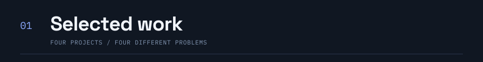
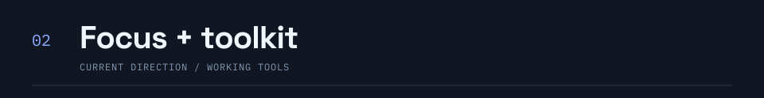
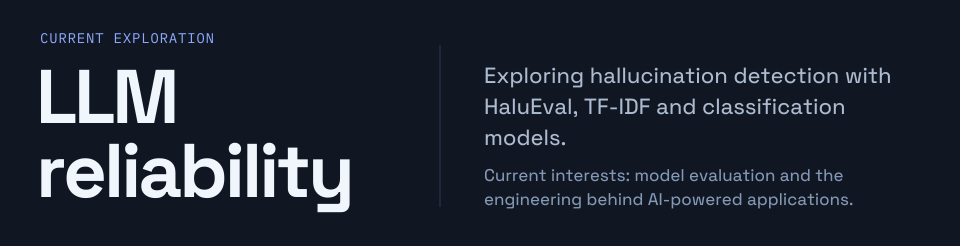
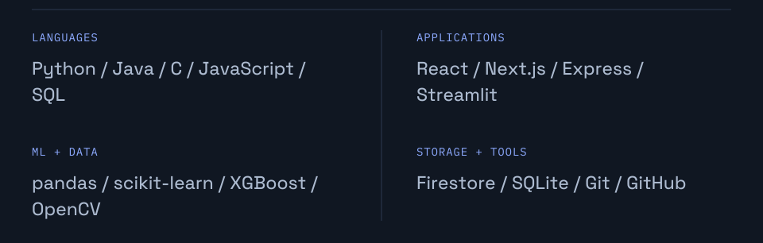
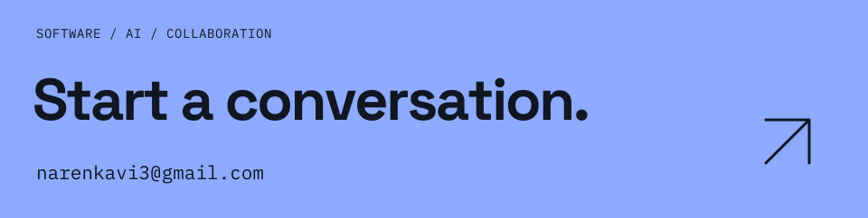

<!-- Generated by scripts/build.py from profile.json. Edit those sources. -->

<picture>
  <source media="(max-width: 600px)" srcset="assets/hero-mobile.svg?v=motion1">
  
</picture>

I'm **Naren K S**, a second-year Computer Science student at **VIT Chennai**. I build across applied AI and the web, from browser instruments to full-stack applications. I like understanding how the data, application logic, and interface fit together.

[Portfolio ↗](https://naren214.github.io/) &nbsp; / &nbsp; [LinkedIn ↗](https://www.linkedin.com/in/naren-k-s-3bb09137a/) &nbsp; / &nbsp; [Email ↗](mailto:narenkavi3@gmail.com)

 

<picture>
  <source media="(max-width: 600px)" srcset="assets/section-work-mobile.svg">
  
</picture>

<a href="https://github.com/naren214/BuildHours">
<picture>
  <source media="(max-width: 600px)" srcset="assets/project-unheard-mobile.svg?v=motion1">
  
</picture>
</a>

<a href="https://github.com/naren214/gdg_rec_portal">
<picture>
  <source media="(max-width: 600px)" srcset="assets/project-gdg-mobile.svg?v=motion1">
  
</picture>
</a>

<a href="https://github.com/naren214/rapid-response-dronemapper">
<picture>
  <source media="(max-width: 600px)" srcset="assets/project-drone-mobile.svg?v=motion1">
  
</picture>
</a>

<a href="https://github.com/naren214/TermVision">
<picture>
  <source media="(max-width: 600px)" srcset="assets/project-termvision-mobile.svg?v=motion1">
  
</picture>
</a>

[Explore all repositories ↗](https://github.com/naren214?tab=repositories)

 

<picture>
  <source media="(max-width: 600px)" srcset="assets/section-focus-mobile.svg">
  
</picture>

<picture>
  <source media="(max-width: 600px)" srcset="assets/focus-mobile.svg">
  
</picture>

<picture>
  <source media="(max-width: 600px)" srcset="assets/toolkit-mobile.svg">
  
</picture>

 

<a href="mailto:narenkavi3@gmail.com">
<picture>
  <source media="(max-width: 600px)" srcset="assets/contact-mobile.svg">
  
</picture>
</a>

[Portfolio](https://naren214.github.io/) &nbsp; / &nbsp; [LinkedIn](https://www.linkedin.com/in/naren-k-s-3bb09137a/) &nbsp; / &nbsp; [Email](mailto:narenkavi3@gmail.com)

 

Project index &amp; text overview

### [UNHEARD](https://github.com/naren214/BuildHours)

Draw a gesture. Hear an instrument. A browser studio mapping movement to pitch, timing and stereo position. Six synthesized presets. Compositions saved locally.

React · Web Audio · Canvas

### [Recruitment Portal](https://github.com/naren214/gdg_rec_portal)

Applications with rules enforced on the server. Extended an existing portal with student applications and coordinator review. Firestore transactions enforce limits and prevent duplicates.

Next.js · Better Auth · Firestore

### [Drone Mapper](https://github.com/naren214/rapid-response-dronemapper)

A quicker first look at disaster imagery. A hackathon prototype for AI hazard summaries, severity estimates and image mapping. Missing GPS uses demo coordinates.

Python · Streamlit · Google GenAI

### [TermVision](https://github.com/naren214/TermVision)

Video, translated into a terminal's language. Full-color ASCII playback with resize-aware output and frame skipping. Optional audio playback on Windows.

Python · OpenCV · NumPy

### Current focus

Exploring hallucination detection with HaluEval, TF-IDF and classification models. Current interests: model evaluation and the engineering behind AI-powered applications.

### Working toolkit

- **Languages:** Python, Java, C, JavaScript, SQL

- **Applications:** React, Next.js, Express, Streamlit

- **Ml + Data:** pandas, scikit-learn, XGBoost, OpenCV

- **Storage + Tools:** Firestore, SQLite, Git, GitHub

