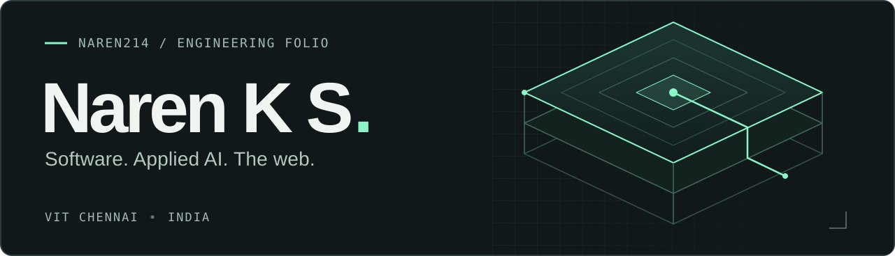

<picture>
  <source media="(max-width: 600px) and (prefers-color-scheme: dark)" srcset="assets/header-mobile-dark.svg">
  <source media="(max-width: 600px) and (prefers-color-scheme: light)" srcset="assets/header-mobile-light.svg">
  <source media="(prefers-color-scheme: dark)" srcset="assets/header-dark.svg">
  <source media="(prefers-color-scheme: light)" srcset="assets/header-light.svg">
  
</picture>

 

**Building software across applied AI and the web.**

I'm Naren, a second-year Computer Science student at VIT Chennai. My projects span browser instruments, full-stack applications, and AI-assisted tools. I'm interested in how data, application logic, and interfaces fit together.

[Portfolio](https://naren214.github.io/) &nbsp; / &nbsp; [LinkedIn](https://www.linkedin.com/in/naren-k-s-3bb09137a/) &nbsp; / &nbsp; [Email](mailto:narenkavi3@gmail.com)

 

## Selected work

### [UNHEARD ↗](https://github.com/naren214/BuildHours)

A browser instrument studio that turns drawn gestures into sound. Maps movement to pitch, duration, intensity, and stereo position, with six synthesized instrument presets and locally saved compositions.

`React` `JavaScript` `Web Audio API` `Canvas`

### [GDG Recruitment Portal ↗](https://github.com/naren214/gdg_rec_portal)

Student applications and coordinator review, built on an existing recruitment codebase. Server-side validation and Firestore transactions enforce department limits and prevent duplicate submissions.

`Next.js` `React` `Better Auth` `Firestore`

### [Rapid Response Drone Mapper ↗](https://github.com/naren214/rapid-response-dronemapper)

A hackathon prototype for reviewing drone imagery after disasters. Combines AI-generated hazard summaries and severity estimates with image previews and mapping. Uses EXIF GPS when available, with demo coordinates as a fallback.

`Python` `Streamlit` `Google GenAI` `pandas` `Pillow`

### [TermVision ↗](https://github.com/naren214/TermVision)

A video player that renders full-color ASCII directly in the terminal. Handles terminal resizing and frame skipping, with optional audio playback on Windows.

`Python` `OpenCV` `NumPy` `FFmpeg`

More to explore: [LinkLite](https://github.com/naren214/NarenLinkShortener) · [Velora Café](https://github.com/naren214/velora-cafe-website) · [All repositories](https://github.com/naren214?tab=repositories)

 

## Working toolkit

| Area | Technologies |
| :--- | :--- |
| Languages | Python · Java · C · JavaScript · SQL |
| Web & applications | React · Next.js · Node.js · Express · Streamlit |
| Data & machine learning | pandas · NumPy · scikit-learn · XGBoost · OpenCV |
| Storage & tools | Firestore · SQLite · Git · GitHub |

 

## Current focus

LLM reliability, model evaluation, and the engineering behind AI-powered applications. My HaluEval work explores hallucination detection with TF-IDF and classification models.

I'm open to software and AI project collaborations. [Get in touch ↗](mailto:narenkavi3@gmail.com)
